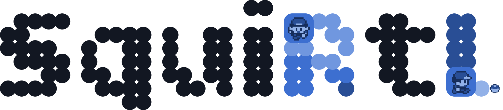
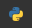

<p align="center">
  <picture>
    <source media="(prefers-color-scheme: dark)" srcset="../docs/assets/logo-dark.svg">
    
  </picture>
</p>

<p align="center"><em>An agent that learns the walk to Oak’s lab.</em></p>

<p align="center">
  <a href="https://www.python.org/"></a>
  <a href="https://github.com/Jybbs/squirtl/actions/workflows/pages.yml?query=branch%3Amain"></a>
  <a href="https://squirtl.fyi/"></a>
</p>

*SquiRtL* trains an agent to play Pokémon Blue from the screen alone. A deep Q-network, PQN, or PPO reads the frames the PyBoy emulator draws, presses one of the Game Boy's buttons each step, and learns from a reward read out of the game's memory, until Blue walks from his bedroom to Oak's lab and chooses his starter, or reaches a later flag a run names as its goal, as far as the Pokédex. **[Methods](https://squirtl.fyi/methods/)** sets out the environment, the reward, the agents, and how each is evaluated, and **[Commands](https://squirtl.fyi/commands/)** lists every command beside each setting it takes.

## 👟 Quickstart

[mise](https://mise.jdx.dev) installs every tool `.mise/config.toml` pins, after [activating it in your shell](https://mise.jdx.dev/installing-mise.html):

```bash
git clone https://github.com/Jybbs/squirtl.git
mise trust squirtl
mise -C squirtl install
cd squirtl
mise doctor project
```

*SquiRtL* ships no part of the game, so it runs on your own copy of the English Pokémon Blue ROM at `data/rom.gb`, which `.gitignore` keeps out of `git status` and a run refuses unless its SHA-1 is the one [pret/pokered](https://github.com/pret/pokered) lists. Then train an agent and evaluate it against random presses:

```bash
squirtl train
squirtl evaluate data/runs/<run>
```

`squirtl train` prints the run's directory under `data/runs/` once it ends, and `squirtl evaluate` prints its measures as Markdown beside the random baseline's under the same seeds.

Each release attaches every run the [Results](https://squirtl.fyi/results/) page measures, each recording the cartridge at `data/rom.gb`. `squirtl fetch` unpacks a release's runs under `data/runs/`, and `--release` plays or measures them in place of a run directory, fetching any run that is missing:

```bash
squirtl watch --release 0.2.0
squirtl evaluate --release 0.2.0 --agent ppo --start curriculum
```

## 🧵 Development

Each step of the development loop runs as a mise task, which `mise tasks` lists in full:

| **Command** | **What It Does** |
|---|---|
| `mise test` | *Runs the test suite* |
| `mise coverage` | *Runs the suite under coverage, fails when the total falls below **95%**, and writes the HTML report under `.cache/coverage/html/` beside the JSON report the site serves the figure from* |
| `mise lint` | *Reports every rewrite the formatter would make and every lint finding* |
| `mise format` | *Rewrites the Python source to the house style* |
| `mise serve` | *Serves the docs site under `docs/` and reloads a page as it is edited* |
| `mise write` | *Writes each file the package declares into `docs/`, the identity's JSON and the theme's sheet among them, and each cited source's footnote definition from `docs/references.bib` into every Markdown file git tracks, all of which `mise audit` holds to what it writes* |
| `mise draw` | *Redraws the logo, the favicon, and the navigation bar's mark from the drawings that set them in the identity* |
| `mise lockfile` | *Verifies `uv.lock`, each task script's lockfile, `.mise/mise.lock`, and `docs/bun.lock` against their manifests, and that every pinned tool installs from `.mise/mise.lock`* |
| `mise relock` | *Re-resolves every lockfile after a change to `pyproject.toml`, `.mise/config.toml`, `docs/package.json`, or a task script's inline metadata* |
| `mise run gha:lint` | *Audits the workflows and the composite action under `.github/` through zizmor* |
| `mise audit` | *Fails on each pin, label, workflow, and layout rule a file departs from, printing each finding as an annotation on the file and line it concerns* |
| `mise labels` | *Writes each label `.github/labels.toml` declares that GitHub lacks or carries under another color or description once you confirm it, and lists each live label the registry leaves out* |
| `mise rulesets` | *Applies the rulesets under `.github/rulesets/`, then the repository settings `.github/settings.toml` declares, once you confirm them* |
| `mise lift` | *Reports every pin lagging its newest release beside the open Dependabot alerts a lift clears, tries the lift in a scratch clone under `--try`, and writes it into every home of each pin under `--write`, leaving each pin `.mise/holds.toml` or `--hold` names where it stands, beside each pin paired with one, stopping the write with every file as it stood where another lift would move a held package, and leaving `min_version` where it stands while the running mise is older than its newest release* |
| `mise attach` | *Packs every committed run through `squirtl pack` and uploads each tar and the manifest to the draft release once you confirm it, replacing any asset already attached* |
| `mise bump` | *Moves the version to the next minor release, or to the next patch release under `mise bump patch`, in `pyproject.toml`, `uv.lock`, and `CITATION.cff`* |
| `mise ci` | *Runs the lockfile check, the workflow audit, the repository audit, the formatter's check, the suite under coverage, and every check of the docs site in one sweep* |

## 🎒 Results

<!-- results -->

**[Results](https://squirtl.fyi/results/)** compares each agent against random presses under the same 5 seeds, where PPO reaches `EVENT_GOT_STARTER` in every evaluation episode from the bedroom and along the curriculum, DQN in no evaluation episode from the bedroom, PQN in no evaluation episode from the bedroom and along the curriculum, and random presses in 21% [14, 31].

<!-- /results -->

## 🕹️ Attribution

*SquiRtL* began as a project for Northeastern University's CS5800 Algorithms course.
